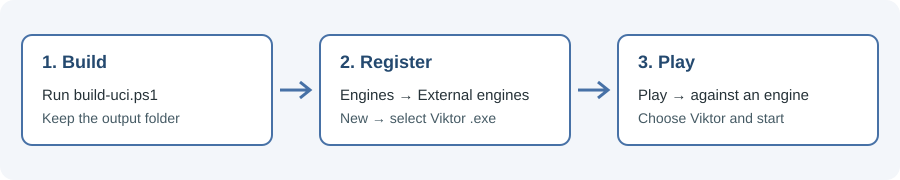
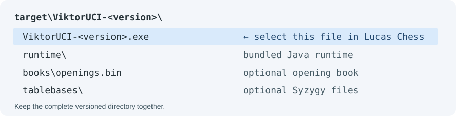

# Using Viktor with Lucas Chess

This guide covers the Windows standalone UCI engine and Lucas Chess. Menu labels
can vary with the application's version and language. The illustrations are
schematic diagrams, not screenshots of Lucas Chess.



## 1. Build the engine

Install Maven and a JDK 21 or later that includes `javac`, `jar` and `jpackage`.
Open PowerShell in the Viktor project root and run:

```powershell
.\build-uci.ps1
```

The script creates `target\ViktorUCI-<version>\ViktorUCI-<version>.exe`, where
`<version>` comes from `pom.xml`. It will not overwrite an existing build of
the same version; move or remove that directory before rebuilding, or choose
another destination with `.\build-uci.ps1 -Destination target\other-builds`.

The executable needs the rest of its generated directory, including its
bundled Java runtime. Keep the whole directory together if you move it.



The book and tablebases are optional external files. The script copies them
when available and warns if they are missing or incomplete; Viktor can still
play using search. See [resource setup](guide.md#starting-a-game) and
[local endgame tables](guide.md#local-endgame-tables) for installation and
redistribution details.

## 2. Add Viktor to Lucas Chess

1. Install or open [Lucas Chess for Windows](https://lucaschess.pythonanywhere.com/downloads).
2. Open **Engines → External engines** and choose **New**.
3. Select the generated `ViktorUCI-<version>.exe`, not the project JAR or a
   Java executable. Wait for Lucas Chess to read the engine information.
4. Accept the engine details and close the external engines window. Viktor
   should appear in the external engines list.

If you move or rebuild the application directory later, update the registered
executable path in Lucas Chess.

## 3. Start a game

1. Open **Play → Play against an engine**.
2. Choose Viktor from the external engines, select your color, and set a
   thinking time or depth.
3. Start the game and make a move. Viktor should reply through the GUI.

Viktor supports time, depth and clock-based searches, but not pondering,
`searchmoves` or node limits. The GUI controls the clock and game result,
including draw adjudication.

## Optional: configure the book and tablebases

In **Engines → External engines**, select Viktor to see its UCI options. The
packaged defaults look for `books\openings.bin` and `tablebases\` next to the
executable, independently of Lucas Chess's working directory. To use other
locations, set `BookFile` and `SyzygyPath`, preferably to absolute paths. Set
`OwnBook` to `false` to disable the book or set `SyzygyPath` to `<empty>` to
disable tablebases. Restart the engine after replacing table files that are in
use on Windows.

## Troubleshooting

- **The build fails:** check that Maven and the full JDK are available in
  PowerShell, including `jpackage`. If the output directory already exists,
  use a different destination or move the existing build.
- **Lucas Chess cannot load the engine:** select the versioned `.exe` and
  verify that its entire application directory is present. To check the UCI
  handshake independently, run the executable in PowerShell, type `uci` and
  then `isready`; look for `uciok` and `readyok`. Type `quit` to exit.
- **Viktor does not appear when starting a game:** check that it is listed in
  **External engines**, then select it as the opponent rather than an internal
  engine. Re-register it if its executable path has changed.
- **Book or tablebase warnings:** check the files and paths, or disable the
  corresponding option. Viktor falls back to search.

Viktor's UCI logs are in `%USERPROFILE%\Viktor\logs` on Windows. They may
contain positions and move histories, so review them before sharing. See
[search diagnostics](guide.md#search-diagnostics) for details.
